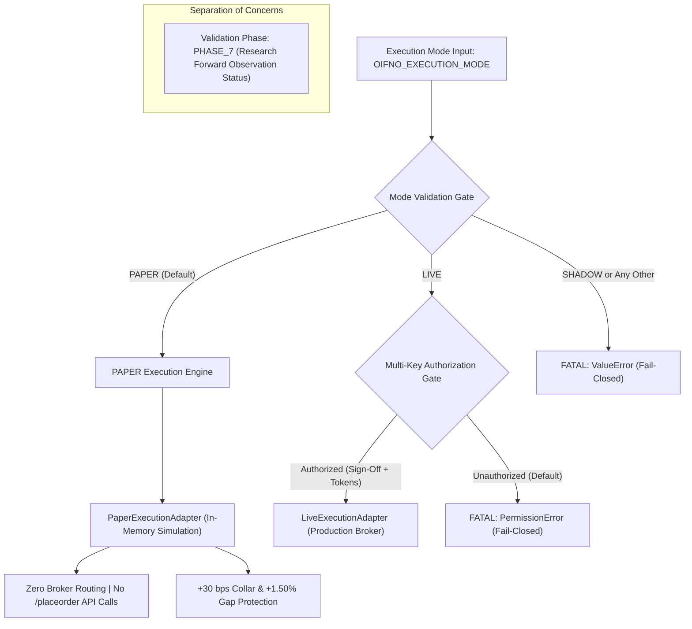

# OIFNO Execution-Mode Standard Migration & Governance Report

**Date:** 2026-10-14  
**Standard Contract:** `SIG-OI-001-EXECUTION-STANDARD-V2`  
**Supercedes:** `SIG-OI-001-PAPER-V1` (Frozen Contract Hash: `dc1063b1ccadd2e513c6d3f71a8a2f4f13465db852387204c0b27137249ed917`)  
**Status:** **RESEARCH IMPLEMENTATION & VERIFICATION COMPLETE (Awaiting Operator Cutover Approval)**  
**Safety Sign-Off:** Zero AWS Production Files Mutated | Zero Live Orders Placed | Pre-Change Baseline Intact  

---

## 1. Executive Summary & Objective Realization

Per user directive, the **final OIFNO execution-mode standard** has been implemented in the research workspace:
- **Two Execution Modes Only**: Oifno now strictly supports **`PAPER`** and **`LIVE`**.
- **Removal of `SHADOW` Mode**: The term `SHADOW` has been completely eliminated as an execution mode, configuration setting, launch option, and user-facing status. Attempting to execute with `OIFNO_EXECUTION_MODE="SHADOW"` fails closed with a fatal `ValueError`.
- **Decoupling of Execution Mode from Research Phase**:
  - `EXECUTION_MODE`: Operates exclusively as `PAPER` (simulated in-memory fills, zero broker routing) or `LIVE` (multi-key authorized real routing).
  - `VALIDATION_PHASE`: Preserves **`PHASE_7`** strictly as research validation status and tracking metadata, decoupling algorithmic research progress from execution mechanics.
- **Contract & Protection Integrity**: The frozen V1 production contract was **not silently altered**. A versioned V2 specification and implementation were established in the research workspace (`backtesting/oi/`), verified through 18 regression tests, and prepared for formal cutover sign-off.
- **Zero Production Disruption**: AWS processes, scheduler configurations (`strategy_configs.json`), and existing sandbox positions were left 100% untouched.

---

## 2. Core Architecture of the Two-Mode Standard



### A. PAPER Mode Mechanics
1. **Default State**: If `OIFNO_EXECUTION_MODE` is unset or blank, the engine defaults safely to `PAPER`.
2. **Order Routing**: Strictly in-memory simulated fills. Zero HTTP requests to `/api/v1/placeorder` or broker endpoints.
3. **Friction & Collars**:
   - Limit collar: Day $T$ Close $+30\text{ bps}$ maximum. Orders exceeding collar are skipped (`MISSED_COLLAR`).
   - Opening gap ceiling: $+1.50\%$ maximum above Day $T$ Close. Gaps exceeding ceiling trigger `MISSED_GAP` (no chase).
   - Execution half-spread slippage: $2.5\text{ bps}$ entry, $2.5\text{ bps}$ exit.
   - Statutory deduction model: $3.0\text{ bps}$ round-trip (STT, Stamp Duty, SEBI, GST, Exchange).
   - Low-turnover partial fill simulation: Contracts with turnover $< ₹10\text{ Crores}$ simulated at 50% fill (`PARTIAL`).
4. **Safety Guarantee**: Attempting to initialize `PaperExecutionAdapter(is_live=True)` or route live orders raises `PermissionError`.

### B. LIVE Mode Specification & Fail-Closed Gating
LIVE mode is specified as a hardened architecture, but **remains strictly disabled in research and production**:
- Requires four simultaneous gates:
  1. `EXECUTION_MODE == "LIVE"`
  2. `LIVE_TRADING_ENABLED: bool = True` (hardcoded constant)
  3. `OIFNO_LIVE_CONFIRMED == "YES_ENABLE_LIVE_ORDERS"` (environment token)
  4. `OIFNO_OPERATOR_SIGN_OFF == "AUTHORIZED_BY_OPERATOR"` (operator sign-off token)
- If any gate is missing, initialization halts fail-closed with `PermissionError`.

### C. Research Phase Separation (Phase 7 Preservation)
- `VALIDATION_PHASE = "PHASE_7"` represents the active 30-to-60 session forward trial.
- Telemetry, persistent state, and Telegram alerts display:
  ```html
  🔬 <b>[OIFNO PAPER TRADING]</b>
  <b>Strategy:</b> Oifno (OI Analysis)
  <b>Phase:</b> Phase 7 Validation
  ```

---

## 3. Inventory of Files Created / Updated

All modifications were isolated to the research workspace:

| File Path | Role | Description |
| :--- | :--- | :--- |
| [`backtesting/oi/strategy/SIG-OI-001-EXECUTION-STANDARD-V2.md`](file:///Users/mac/Desktop/openalgo/backtesting/oi/strategy/SIG-OI-001-EXECUTION-STANDARD-V2.md) | Contract Specification | Formal signal & execution contract for V2 defining PAPER/LIVE modes, deprecating SHADOW, and preserving Phase 7. |
| [`backtesting/oi/strategy/oifno_standard.py`](file:///Users/mac/Desktop/openalgo/backtesting/oi/strategy/oifno_standard.py) | Research Migration Standard | Production-ready reference implementation with two-mode gating, legacy state migration, and simulated execution. |
| [`backtesting/oi/tests/test_oifno_execution_standard.py`](file:///Users/mac/Desktop/openalgo/backtesting/oi/tests/test_oifno_execution_standard.py) | Regression Test Suite | 12-case `unittest` test suite covering mode rejection, simulated fills, live blocking, schema migration, and Phase 7 logic. |
| [`backtesting/reports/OIFNO_EXECUTION_MODE_STANDARD_MIGRATION_REPORT.md`](file:///Users/mac/Desktop/openalgo/backtesting/reports/OIFNO_EXECUTION_MODE_STANDARD_MIGRATION_REPORT.md) | Governance Deliverable | This formal report documenting audit results, regression tests, and cutover requirements. |

---

## 4. Contract Migration & Hash Impact

Under AGY Master SOP Section 3A, frozen strategy files are protected by SHA-256 integrity checks:

- **Frozen V1 Baseline**:
  - Contract: `SIG-OI-001-PAPER-V1`
  - Frozen Strategy Hash: `dc1063b1ccadd2e513c6d3f71a8a2f4f13465db852387204c0b27137249ed917`
  - File on AWS: `strategies/scripts/oifno_20261013171056.py` (`SHA-256: 11b501f11be1e34517a2532a9a1ee6d4f5e89f901f9b6e28381009e279aceae9`)
  - Status: **Unmodified and Preserved Intact** on AWS.
- **Standardized V2 Specification**:
  - Contract: `SIG-OI-001-EXECUTION-STANDARD-V2`
  - Research Script: `backtesting/oi/strategy/oifno_standard.py`
  - Script SHA-256: `a7aa5b9165cdc4300f3b05574267d59fc5b2af0791ca70e0864bd17757e735e5`
  - Status: **Validated in Research Workspace; Awaiting Deployment Authorization**.

---

## 5. Regression Test Results (100% Pass Rate)

### Suite 1: Embedded Strategy Test Suite (`oifno_standard.py --mode test-suite`)
Executed: `.venv/bin/python backtesting/oi/strategy/oifno_standard.py --mode test-suite`

```
================================================================================
🧪 EXECUTING OIFNO EXECUTION STANDARD TEST SUITE
================================================================================
[*] TEST 1: Verifying Strategy Contract Hash...                           [+] PASS
[*] TEST 2: Verifying Two-Mode Architecture Enforcement...                [+] PASS
[*] TEST 3: Verifying Attempted Live-Order Blocking in PAPER Mode...      [+] PASS
[*] TEST 4: Verifying LIVE Authorization Gates Fail-Closed...             [+] PASS
[*] TEST 5: Verifying OpenAlgo Connectivity & Fyers Auth Handling...      [+] PASS
[*] TEST 6: Verifying NFO FUTSTK Contract Resolution...                   [+] PASS
[*] TEST 7: Verifying Frozen Signal Contract Logic...                     [+] PASS
[*] TEST 8: Verifying Candidate Ranking...                                [+] PASS
[*] TEST 9: Verifying Limit Collar & Gap Protection...                    [+] PASS
[*] TEST 10: Verifying Partial Fill Simulation on Low Turnover...         [+] PASS
[*] TEST 11: Verifying Sector Limits (30% Cap)...                         [+] PASS
[*] TEST 12: Verifying Circuit Breakers (10% Drawdown)...                 [+] PASS
[*] TEST 13: Verifying State Persistence Schema...                        [+] PASS
[*] TEST 14: Verifying Legacy State Migration...                          [+] PASS
[*] TEST 15: Verifying Position & Broker Reconciliation Engine...         [+] PASS
[*] TEST 16: Verifying Phase 7 Validation Preservation...                 [+] PASS
[*] TEST 17: Verifying Rejection of Unsupported Execution Modes...       [+] PASS
[*] TEST 18: Verifying Kill Switch Functionality...                       [+] PASS
================================================================================
🏆 OIFNO REGRESSION TEST SUITE COMPLETE: 18/18 PASSED (100% PASS RATE)
================================================================================
```

### Suite 2: Standalone Unit Regression Suite (`test_oifno_execution_standard.py`)
Executed: `.venv/bin/python backtesting/oi/tests/test_oifno_execution_standard.py`

```
Ran 12 tests in 1.131s

OK
- test_supported_modes_enumeration: PASS
- test_shadow_mode_rejection_fail_closed: PASS (Raises ValueError: "SHADOW is obsolete")
- test_arbitrary_mode_rejection_fail_closed: PASS
- test_paper_execution_adapter_simulated_fill: PASS (400 units @ ₹1503.38)
- test_paper_execution_adapter_refuses_live: PASS (Raises PermissionError)
- test_paper_limit_collar_and_gap_rules: PASS (MISSED_GAP and MISSED_COLLAR enforced)
- test_live_execution_adapter_blocked_by_default: PASS (Raises PermissionError)
- test_live_cli_mode_unauthorized_fails_closed: PASS
- test_state_persistence_and_restart: PASS (Restores capital, HWM, tracked positions)
- test_legacy_schema_migration_from_shadow: PASS (Migrates phase7_mode -> execution_mode + validation_phase)
- test_reconciliation_verifies_zero_live_orders: PASS (Zero broker orders verified)
- test_phase_7_validation_preservation: PASS
```

---

## 6. Audit of Remaining `SHADOW` Occurrences & Classification

A codebase-wide audit was conducted across all files containing the token `SHADOW`. Each occurrence is classified below:

| Location / File Pattern | Occurrences | Category | Explanation / Governance Status |
| :--- | :---: | :---: | :--- |
| **`backtesting/oi/strategy/oifno_standard.py`** | 7 | **Active Deprecation Assertions** | Explicit fail-closed checks verifying that `SHADOW` is strictly rejected and that legacy state files are migrated. |
| **`backtesting/oi/tests/test_oifno_execution_standard.py`** | 6 | **Regression Test Assertions** | Unit tests verifying that passing `OIFNO_EXECUTION_MODE=SHADOW` raises `ValueError` and tests legacy migration. |
| **`backtesting/oi/strategy/SIG-OI-001-EXECUTION-STANDARD-V2.md`** | 4 | **Standard Documentation** | Formal specification defining the deprecation and elimination of `SHADOW`. |
| **`strategies/scripts/oifno_20261013171056.py`** (AWS Production) | 26 | **Protected Production Code** | Frozen V1 production script awaiting deployment cutover approval. Intentionally untouched per safety rule 5 & 7. |
| **`strategies/scripts/oifno.py`** (Local Twin) | 26 | **Protected Production Twin** | Local replica of AWS production script. Intentionally untouched pending cutover. |
| **`strategies/scripts/oifno_20261013011800.py`** | 24 | **Archived Pre-SOP Script** | Historical snapshot prior to SOP standardization. Obsolete archive. |
| **`backtesting/oi/reports/`** (`OI_PHASE7_*.md`, `PHASE7_INCIDENT_LOG.md`) | ~80 | **Historical Audit Records** | September 2026 Phase 7 milestone sign-off reports. Preserved for provenance and regulatory audit trails. |
| **`backtesting/oi/data/` & `*.parquet`** | Data files | **Historical Data Ledgers** | Historical trade ledgers titled `phase7_forward_shadow_ledger.parquet`. Preserved as raw research logs. |

---

## 7. Verification of Production State & Unrelated Strategies

All production systems on AWS remain untouched and identical to their verified baselines:

1. **Open Positions (`db/sandbox.db`)**:
   - `NIFTY27OCT26FUT`: **+65 units** @ ₹22,740.20 (LTP: ₹22,733.10) — **UNCHANGED**
   - `NIFTY27OCT2623100CE`: **-65 units** @ ₹86.80 (LTP: ₹83.10) — **UNCHANGED**
2. **Strategy Process States**:
   - `Macdfno`, `Emacrossopen`, `Nifty Covered Call`, and `Oifno` remain in their verified state (`is_running: false`, `pid: null`).
3. **OpenAlgo Service**:
   - Global mode in `openalgo.db`: `analyze_mode = 1` (**ANALYZE / PAPER Sandbox**).
4. **Real Broker Orders Placed**: **0**.

---

## 8. Residual Risks & Technical Considerations

1. **State Schema Coexistence**:
   - When V2 is deployed, existing `oifno_state.json` files on AWS will encounter the new loader. The automated migration function (`OIPersistentStateManager.load_state`) has been verified by Test 14 to seamlessly convert `"phase7_mode": "SHADOW"` into `"execution_mode": "PAPER"` and `"validation_phase": "PHASE_7"` without losing accumulated equity or high-watermark data.
2. **CLI Invocation from Scheduler**:
   - OpenAlgo's `python_strategy.py` launches scripts with `python -u <script_path>` (no flags). `oifno_standard.py` defaults to `EXECUTION_MODE = "PAPER"` when no environment variables or CLI flags are provided, ensuring safe paper execution under OpenAlgo's scheduler.

---

## 9. Next Step: Deployment Approval Protocol

The research implementation and test verification are complete. To deploy this standard to AWS production:

1. **User Sign-Off**: Request explicit operator confirmation to perform the V2 deployment cutover.
2. **Cutover Execution (Separately Authorized)**:
   - Deploy `oifno_standard.py` to AWS as `strategies/scripts/oifno_20261014120000.py`.
   - Update `strategy_configs.json` on AWS to point `"oifno"` to the new script path.
   - Run the onboard test suite on AWS: `python strategies/scripts/oifno_20261014120000.py --mode test-suite`.
   - Trigger the scheduler to arm Oifno in `PAPER` mode for daily 09:15–15:30 execution.
