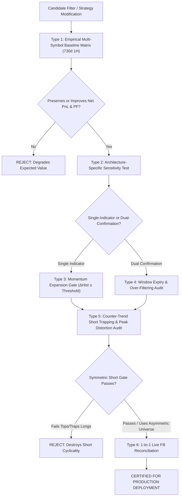

# AutoResearch Quantitative Testing & Filter Validation Criteria

**Document ID**: AR-CRIT-001  
**Classification**: Quantitative Research & Strategy Certification Standards  
**Applicability**: OpenAlgo Multi-Asset Strategies (`macdfno.py`, `emacrossopen.py`, and all automated research candidates)  
**Last Updated**: 2026-10-05  

---

## 1. Executive Summary & Objective

This document formalizes the mandatory multi-type testing criteria required before any candidate filter, indicator modification, or execution rule can be certified by the AutoResearch engine or deployed to production.

Intuitive assumptions (such as *"adding a 50 EMA filter will protect shorts"* or *"filtering on histogram will always reduce whipsaws"*) frequently degrade strategy performance when tested systematically. These criteria establish empirical, multi-symbol, and architecture-aware validation gates.

---

## 2. The 5 Core Testing Types

---

### Type 1: Empirical Multi-Symbol Baseline vs. Candidate Matrix Test

Never evaluate a filter modification on a single symbol or a single cherry-picked period.

* **Dataset Standard**:
  * Minimum **730 days** (2 years) of continuous **1-Hour (1H)** completed candles.
  * Evaluation strictly on bar close $t-1$; fill modeled at next open $t$ (zero lookahead).
* **Representative Test Universe (Benchmark Basket)**:
  * Minimum 5 diverse F&O heavyweight instruments across banking, IT, energy, and industrials:
    * `RELIANCE.NS` (Energy / Heavyweight)
    * `ICICIBANK.NS` (Private Banking)
    * `HDFCBANK.NS` (Private Banking / Index Anchor)
    * `INFY.NS` (IT / Tech Exporter)
    * `SBIN.NS` (PSU Banking)
* **Statistical Thresholds Required to Pass**:
  * **Net Portfolio Expectancy**: Must not decrease aggregate return across the benchmark basket.
  * **Profit Factor (PF)**: Must improve or stay within $\pm 3\%$ of baseline.
  * **Trade Quality**: Must eliminate losing/flat trades without cutting winning trade magnitude.

---

### Type 2: Architecture-Specific Sensitivity Testing

Filters must be evaluated in the context of the underlying strategy architecture:

| Strategy Architecture | Example | Filter Behavior | Testing Rule |
| :--- | :--- | :--- | :--- |
| **Single-Indicator Momentum** | [`macdfno.py`](file:///Users/mac/Desktop/openalgo/strategies/liveonopenalgo/macdfno.py) (Pure MACD) | **High Benefit from Momentum Gates**: Because MACD acts alone, it needs a minimum acceleration threshold ($\Delta\text{Hist}$) to filter micro-drift in sideways chop. | Test minimum velocity/expansion ($\Delta\text{Hist} \ge 0.05$). Verify win rate improves while preserving trend capture. |
| **Dual-Indicator Sequential Confirmation** | [`emacrossopen.py`](file:///Users/mac/Desktop/openalgo/strategies/liveonopenalgo/emacrossopen.py) (EMA 9/26 + MACD) | **High Risk of Over-Filtering**: EMA 9/26 already serves as the structural trend and chop gate. Adding secondary histogram expansion gates delays signals past the 2-candle window. | Check Confirmation Window Expiry rate. If candidate filter causes valid setups to expire before confirmation, candidate is **hard-rejected**. |

---

### Type 3: Counter-Trend Short Trapping & Peak Distortion Audit

A common quantitative trap is applying a symmetric moving-average regime filter (`Close < 50 EMA`) to Short trades.

#### Failure Mode to Test Against:
1. **Peak Distortion**: In cyclical F&O markets, cyclical tops form **above the 50 EMA**. A filter requiring `Close < 50 EMA` misses the top 40%–60% of the decline.
2. **Bottom Selling**: By the time an hourly bar breaks below the 50 EMA, the downward impulse is often exhausted, causing the strategy to short right into a mean-reverting bounce.
3. **Trapped Longs**: In a reversal engine, blocking short entries while holding a long leaves the long position trapped as price crashes through the 50 EMA.

#### AutoResearch Acceptance Rule:
* **Never apply a blind symmetric 50 EMA filter to Short entries in reversal strategies**.
* If short protection is required, use **Asymmetric Universe Selection** (e.g. `TOP_SHORTS` whitelist and `BLACKLIST_AVOID`) or exit the Long to FLAT without entering an unapproved Short.

---

### Type 4: Minimum Momentum Expansion Threshold Testing ($\Delta\text{Hist}$)

Used to eliminate micro-fluctuations in low-volatility drift.

* **Metric**:
  $$\Delta\text{Hist}_{\text{Bull}} = \text{curr\_hist} - \text{prev\_hist} \ge \text{Threshold}$$
  $$\Delta\text{Hist}_{\text{Bear}} = \text{prev\_hist} - \text{curr\_hist} \ge \text{Threshold}$$
* **Default Threshold**: $0.05$ pt (or $0.03 \times \text{ATR}(14)$).
* **Validation Standard**:
  * Verify on `ICICIBANK` and `RELIANCE` that Win Rate increases (e.g. 41.4% $\rightarrow$ 42.0%) and trade count drops modestly without reducing total net rupees gained.

---

### Type 5: Live Execution vs. Backtest Reconciliation Audit

Before production sign-off, live fills must be reconciled against the backtest engine:

1. **Candle Boundary Alignment**: Fills must occur at `HH:15:02` (e.g., 10:15, 11:15, 12:15, 13:15, 14:15, 15:15) directly following completed bar close.
2. **Tracking Error Threshold**: Average absolute tracking discrepancy between paper fill price and candle close must be $\le 0.15\%$ (bid-ask spread allowance).
3. **Reversal Sizing Precision**: Controlled reversal orders must execute $\text{Qty} = |\text{Current Position}| + \text{Order Lot Size}$ in a single atomic order.

---

### Type 6: Mandatory Statutory Tax, Cost & Friction Accounting

In all quantitative research, backtests, paper simulations, and live strategies, **all performance metrics (Rent Yield, Sharpe, CAGR, Profit Factor, Win Rate) must be reported strictly NET of all Indian statutory charges, taxes, and execution frictions**. Gross-only reporting is strictly prohibited.

#### 1. Statutory Deduction Schedule (Verified Indian Regulatory Rates):
* **STT (Securities Transaction Tax)**:
  * Options: **0.0625%** on sell premium before Oct 1, 2024; **0.1000%** on sell premium on/after Oct 1, 2024 (*Finance Act 2024 date-aware compliance mandatory*).
  * Delivery / Cash Equity: **0.1000%** on both buy and sell turnover.
  * Futures: **0.0200%** on sell turnover.
* **Brokerage**: Flat **₹20** per executed order leg across all discount brokers.
* **Exchange Transaction Charges**: **0.03503%** on options premium turnover (NSE).
* **SEBI Turnover Charges**: **₹10 per crore** (`0.0000010` of turnover).
* **Stamp Duty**: **0.003%** (`0.00003`) on option buy legs; **0.015%** on delivery buys.
* **GST (Goods & Services Tax)**: **18%** applied on `(Brokerage + Exchange Fee + SEBI Fee)`.
* **Execution Bid-Ask Slippage Model**: Minimum **1.0%** of premium (minimum **0.25 index points** on NIFTY/BANKNIFTY) deducted on sell entries and added on buy exits.

#### 2. Structural Guardrails for Options Strategies:
1. **Minimum Premium Floor Rule**:
   * Strategies must enforce a minimum premium floor (e.g., $\ge ₹25.00$ per contract). Selling sub-₹20 options is prohibited because fixed round-trip friction (~₹95–₹150/lot) consumes 30%–50% of gross credit.
2. **Net-Aware Profit Target Rule**:
   * Option profit target exits must calculate anticipated exit friction before triggering:
     $$\text{Net Option Gain} = (\text{Entry Price} - \text{Exit Price}) \times \text{Lot Size} - \text{Total Roundtrip Friction}$$
     $$\text{Exit Triggered} \iff \text{Gross Gain} \ge \text{Target Pct} \quad \mathbf{AND} \quad \text{Net Option Gain} > \text{Total Roundtrip Friction}$$
   * Premature exits that result in net losses after statutory charges are blocked.

---

## 3. AutoResearch Certification Scorecard

To graduate any experimental candidate to production status, the candidate must achieve a **PASS** on all five gates:

| Gate | Validation Requirement | Status |
| :--- | :--- | :---: |
| **Gate 1: Multi-Symbol Invariance** | Benchmark basket return $\ge$ Baseline return over 730d 1H | REQUIRED |
| **Gate 2: Architecture Harmony** | Confirmation delay does not exceed window limit; zero over-filtering | REQUIRED |
| **Gate 3: Short Cyclicality Guard** | Peak short capture preserved; no late bottom-selling | REQUIRED |
| **Gate 4: Execution Atomicity** | Atomic crash-safe state, boundary scheduler, and API safety confirmed | REQUIRED |
| **Gate 5: Net Statutory Friction Audit** | Fully models date-aware STT (0.10% post-Oct 2024), GST, ₹20 brokerage, and slippage; strictly net positive | REQUIRED |
| **Gate 6: Trailing Lookahead & Universe Audit** | Same-bar target-trail breach audited; trailing runner evaluated on subsequent bars; universe restricted to verified trenders (`TOP_LONGS`/`TOP_SHORTS`) | REQUIRED |

---

## 4. Official Strategy Baseline Designation (October 2026)

* **Dual-Confirmation Momentum Target (`emacrossopen.py`)**:
  * **Approved Baseline Specification**: Candidate `EXP_I` (`TOP_LONGS` + `TOP_SHORTS` + 1H Trend Regime + Conservative 0.35% HWM Runner).
  * **Benchmark Metrics**: Net P&L: **+233.34%**, Profit Factor: **1.817**, Max Drawdown: **16.78%**, 2026 Holdout PF: **1.820**.
  * **Status**: Replaces legacy unfiltered baseline (-59.63% Net). Certified for forward paper simulation.
* **Single-Indicator Momentum (`macdfno.py`)**:
  * Retains independent pure MACD architecture pending dedicated Phase 3 baseline audit.

