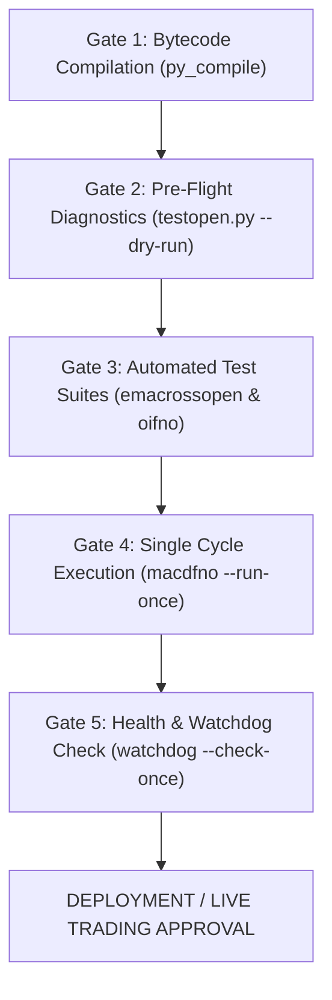

# Standard Operating Procedure (SOP)
## Strategy Credentials Isolation, Security Standards & Production Deployment Checklist

**Document ID**: SOP-STRAT-003  
**Classification**: Production Strategy Security & Operational Standards  
**Target Environment**: Local Workspace & AWS EC2 Production (`https://vikashiname.in` / `13.203.187.139`)  
**Applicability**: All strategies and harnesses in `strategies/liveonopenalgo/`, `strategies/production/`, and `strategies/research/`  
**Last Updated**: 2026-10-06  

---

## 1. Executive Summary & Purpose

This Standard Operating Procedure formalizes the mandatory security and deployment standards for all automated trading strategies connecting to OpenAlgo.

The primary objective is to prevent **credential leakage**, **accidental live execution**, and **uncontrolled order routing** by enforcing complete decoupling between strategy logic and runtime environment secrets.

---

## 2. Core Security Directives

### Directive 1: Zero Hardcoded Secrets (Strict Fail-Closed)
* **Never** hardcode API keys, broker tokens, Telegram bot tokens, chat IDs, or passwords into any Python script, test harness, or configuration file tracked by Git.
* **Never** provide real credentials as default fallback arguments in `os.getenv()` or function signatures:
  ```python
  # ❌ PROHIBITED (Dangerous fallback leaking credentials & causing silent live execution)
  OPENALGO_API_KEY = os.getenv("OPENALGO_API_KEY", "a93a6d4254acb477c693e0776b9c34ef4f129d0a94a4c1c100235186f8e1a41e")

  # ✅ REQUIRED (Clean environment lookup with fail-closed behavior)
  OPENALGO_API_KEY = os.getenv("OPENALGO_API_KEY", "")
  ```

### Directive 2: Standardized `.env` Loading Protocol
All strategy entrypoints and diagnostic harnesses must implement portable `.env` discovery at top of module:

```python
try:
    from dotenv import load_dotenv, find_dotenv
    load_dotenv(find_dotenv(), override=False)
except ImportError:
    pass
```

### Directive 3: Canonical Environment Variables
Environment variables must strictly adhere to standard naming across all strategy components:

| Environment Variable | Description | Example / Target |
| :--- | :--- | :--- |
| `OPENALGO_HOST` | OpenAlgo Server Endpoint | `https://vikashiname.in` |
| `OPENALGO_API_KEY` | Master OpenAlgo API Key | `a93a6d42...` (Kept in `.env`) |
| `TELEGRAM_BOT_TOKEN` | Dedicated Telegram Alert Bot | `8689653506:AA...` (Kept in `.env`) |
| `TELEGRAM_CHAT_ID` | Telegram Notification Destination | `1206560889` (Kept in `.env`) |

---

## 3. Production Pre-Flight Verification Checklist

Before deploying, running live, or committing changes to strategy engines, complete the 5 verification gates:



### Step 1: Bytecode Compilation Gate
Compile all strategy files to ensure zero syntax or import errors:
```bash
.venv/bin/python -m py_compile \
  strategies/liveonopenalgo/emacrossopen.py \
  strategies/liveonopenalgo/macdfno.py \
  strategies/liveonopenalgo/oifno.py \
  strategies/liveonopenalgo/testopen.py \
  strategies/liveonopenalgo/watchdog.py
```
* **Success Criteria**: Return code `0` with zero error output.

### Step 2: Pre-Flight Connectivity & Auth Diagnostics Gate
Run the read-only pre-flight suite to verify host reachability, broker session, telemetry, and market feeds:
```bash
.venv/bin/python strategies/liveonopenalgo/testopen.py --dry-run
```
* **Success Criteria**: All 4 checks display `✅ PASS` and final verdict reports `🟢 SYSTEM READY`.

### Step 3: Strategy Regression Test Suites Gate
Run the built-in test suites for all deterministic logic:
```bash
# 3A. 12-Point Transition & Reversal Matrix
.venv/bin/python test_alert_reversal_matrix.py

# 3B. EMA + MACD 39-Point Assertion Suite
.venv/bin/python strategies/liveonopenalgo/emacrossopen.py --test

# 3C. Strategy Runtime & Process Isolation Audit (Zero Collisions & PID Safety)
.venv/bin/python -m unittest discover -s test -p "test_strategy_runtime_contracts.py"
```
* **Success Criteria**: 100% test pass rate across all test gates. Automatic hard-block if any strategy shares heartbeat paths or un-isolated `.tmp` files.

### Step 4: Single-Cycle Execution & Position Reconciliation Gate
Execute a single non-blocking pass of the portfolio engine:
```bash
.venv/bin/python strategies/liveonopenalgo/macdfno.py --run-once --symbols RELIANCE
```
* **Success Criteria**: Startup positionbook reconciliation completes cleanly with accurate regime alignment audit.

### Step 5: Independent Health Watchdog Gate
Confirm that the watchdog can read heartbeat and report system status:
```bash
.venv/bin/python strategies/liveonopenalgo/watchdog.py --check-once
```
* **Success Criteria**: Returns structured JSON health status and logs current market hours state cleanly.

---

## 4. Git Hygiene & Artifact Exclusion Standards

To prevent leaking state, logs, or backups into Git repositories:

1. **Strictly Ignore Runtime Artifacts** in `strategies/.gitignore`:
   ```gitignore
   # Runtime state files
   liveonopenalgo/*_state.json
   liveonopenalgo/heartbeat.json
   production/audit/*_state.json

   # Logs and dumps
   liveonopenalgo/*.log
   liveonopenalgo/*.csv
   production/audit/*.jsonl
   production/audit/*.parquet

   # Backup and scratch files
   *.bak*
   *.backup_*
   ```

2. **Automated Pre-Commit Secret Scan**:
   Verify no accidental keys exist before pushing:
   ```bash
   git grep -E "[a-f0-9]{64}" strategies/
   ```

---

## 5. Telegram Notification & Reversal Guard Protocol

### Directive 4: Single Unified Notification per Event
1. **Deduplication Rule**: Every trade event must emit exactly **ONE** Telegram message. OpenAlgo EventBus must suppress the generic `Order Placed` message for recognized strategy orders (`MACDFNO`, `EMACROSSOPEN`, `OIFNO`, `NIFTY_COVERED_CALL`).
2. **Standard Notification Format**:
   - **Header**: `🟢 TRADE — ORDER PLACED` (BUY/LONG) or `🔴 TRADE — ORDER PLACED` (SELL/SHORT)
   - **Strategy Name & Mode**: `Strategy: <Name>`, `🔬 PAPER MODE - No Real Orders` / `⚡ LIVE MODE - Real Orders`
     > **Technical Mapping Note:** OpenAlgo's underlying API and order routes use the internal technical parameter `mode: 'analyze'` to instruct the server not to route real broker orders. In user notifications, logs, reports, and documentation, this internal technical setting maps strictly to **Execution Mode: `PAPER`** in compliance with AGY Master SOP Section 21. Real broker order execution maps strictly to **Execution Mode: `LIVE`**.
   - **Contract & Symbol**: `Symbol: <CONTRACT> (<BASE_SYMBOL>)`
   - **Action & Direction**: `Action: BUY / SELL`, `Direction: LONG / SHORT`
   - **Price & Risk Metrics**:
     - `Entry Price: ₹...`
     - `🎯 Target: ₹... (+/-X.X%)`
     - `🛑 Stop Loss: ₹... (-/+X.X%)`
     - `Trigger Price: ₹...` (only when $>0$)
   - **Order Attributes**: `Price Type`, `Exchange`, `Product`, `Order ID`, `Order Status`
   - **Position Transition**: `Position: <before> ➔ <after>`
   - **Timestamp**: `⏰ Time: HH:MM:SS IST`
   - **Indicator & Candle Block**: Completed candle time, Close, and strategy-specific indicator readings.

### Directive 5: Target & Stop Loss Calculation Synchronization
Strategy alerts and risk execution engines must share identical calculation parameters without divergence:
* **`Macdfno` Strategy**:
  - Long: Target `+3.0%`, Catastrophe SL `-3.5%`
  - Short: Target `-1.5%`, Catastrophe SL `+3.5%`
* **`Emacrossopen` Strategy**:
  - Long: Target `+3.0%`, Catastrophe SL `-6.0%`
  - Short: Target `-1.5%`, Catastrophe SL `+6.0%`
* **`Nifty Covered Call` Strategy**:
  - Target: `90%` premium decay (`target = 0.90`)
  - Stop Loss: `3.0x` premium multiplier (`stoploss = 3.0`)

### Directive 5A: Digital-Twin Testing & State Isolation Protocol
Following the standardized **Nifty Covered Call** pattern:
1. Every strategy running in `strategies/liveonopenalgo/<name>.py` must maintain an identical mirror copy in `backtesting/<name>/<name>.py`.
2. All research trials, parameter optimizations, replay tests, and testing runs in isolated sandbox environments must occur within `backtesting/<name>/` using local state files (`SCRIPT_DIR / "<name>_state.json"` or ephemeral `/tmp` state) to ensure **zero contamination** of live production state (`strategies/liveonopenalgo/*_state.json`). Note that "sandbox" describes an isolated research/testing filesystem environment, not an execution mode; all non-live executions operate strictly under **Execution Mode: `PAPER`**.
3. Running regression suites (e.g. `python3 <script> --test`) must achieve 100% pass before promoting code to live.

### Directive 6: Strict Reversal Entry Guard
A reversal (`+Q ➔ -Q` or `-Q ➔ +Q`) is fundamentally an **EXIT of the active position + fresh opposite ENTRY**:
* The opposite ENTRY must satisfy **all standard entry gates**:
  1. `is_entry_time_allowed()` (trading window check)
  2. Trend / regime alignment filter
  3. Signal confirmation windows
* **Fail-Safe Requirement**: If the opposite ENTRY is rejected or occurs during a dead zone / restricted time window, the strategy must transition to **FLAT (`0`)** and **NEVER** flip into the opposite direction.

### Directive 7: Process-Isolated Atomic Persistence & Heartbeat Separation
To guarantee crash safety and prevent race condition file corruptions when multiple strategies run concurrently:
1. **PID-Isolated Atomic Writes**:
   - All state and heartbeat file writes must write to a process-unique temporary file (`.tmp.{os.getpid()}`) before replacing the target file:
     ```python
     temp_file = file_path.with_suffix(f".tmp.{os.getpid()}")
     with open(temp_file, "w") as f:
         json.dump(data, f)
     temp_file.replace(file_path)
     ```
   - **Never** use a shared static `.tmp` extension (e.g. `heartbeat.tmp`), which causes `FileNotFoundError [Errno 2]` collisions between concurrently ticking strategies.
2. **Strategy-Specific Heartbeat Defaults**:
   - Every strategy engine must default to a unique, non-colliding heartbeat filename:
     - `MACD_FNO` $\rightarrow$ `macdfno_heartbeat.json`
     - `EMACROSS` $\rightarrow$ `emacross_heartbeat.json`
     - `OI_FNO` $\rightarrow$ `oifno_heartbeat.json`
     - `NIFTY_COVERED_CALL` $\rightarrow$ `nifty_covered_call_heartbeat.json`
   - **Never** default to a generic `heartbeat.json` in production scripts.
3. **Self-Healing State Recovery**:
   - If a persistent state JSON file is missing, empty, or corrupt, the engine must automatically log a warning and re-initialize a valid, schema-compliant default state without crashing.

### Directive 8: Safe Contract Resolution Caching & Expiry Parsing
1. **Discontinued Symbol Suppression (24-Hour TTL)**:
   - When dynamic contract resolution fails for an instrument (e.g., retired/discontinued F&O contracts by NSE), the engine must cache the unresolvable status for 24 hours via `SafeContractCache`.
   - Strategies must **never** bombard the broker search API with repeated queries for known-dead symbols on every cycle.
2. **Multi-Format Expiry Parsing**:
   - All contract expiry resolvers must support common Indian exchange/broker formats (`%d-%b-%y`, `%d-%b-%Y`, `%d-%B-%y`, `%d-%B-%Y`, `%d-%m-%Y`, `%d-%m-%y`, `%Y-%m-%d`) via `strategies.strategy_runtime.parse_contract_expiry`.

### Directive 9: Unified Multi-Strategy Watchdog Architecture
1. **Single Autonomous Monitor**:
   - The production watchdog (`strategies/liveonopenalgo/watchdog.py`) must monitor all active strategy heartbeats concurrently in a single service (`openalgo-watchdog.service`).
2. **Independent State & Escalation**:
   - Watchdog maintains per-strategy alert tracking in `watchdog_state.json`. If one strategy degrades or misses a heartbeat, alerts specify the exact degraded strategy name while healthy strategies remain undisturbed.
3. **Zero Intervention**:
   - Watchdog is strictly observational: ZERO automated restarts, ZERO order modifications.

---

## 6. Strategy Synchronization & Deployment Checklist

Before rolling out updates to production (AWS EC2 / `vikashiname.in`):

1. **Verify Local vs Production File Parity**:
   Ensure identical copies exist across working directories:
   ```bash
   diff -u strategies/liveonopenalgo/macdfno.py strategies/scripts/macdfno.py
   diff -u strategies/liveonopenalgo/emacrossopen.py strategies/scripts/emacrossopen.py
   diff -u strategies/liveonopenalgo/oifno.py strategies/scripts/oifno.py
   ```

2. **Execute Full Alert & Reversal Test Matrix**:
   Run the 12-point automated test matrix verifying entries, exits, reversals, target hits, stop losses, and deduplication:
   ```bash
   python3 test_alert_reversal_matrix.py
   ```
   * **Success Criteria**: 100% pass (12/12 test cases green).

3. **Deploy & Reload Production Service**:
   On the AWS EC2 instance:
   ```bash
   cd /home/ubuntu/fyersawsog
   git pull origin main
   sudo systemctl restart openalgo.service
   ```

