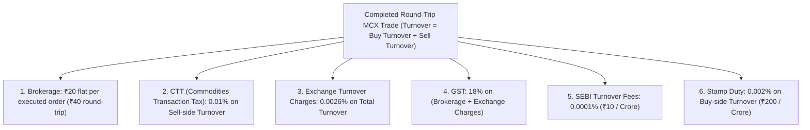

# MCX Gold Futures Quantitative Validation & Ingestion Report

---

### Executive Summary & Critical Data Disclosure

> [!CAUTION]
> ### Status: MCX validation unavailable with current data.
> **Verification Audit Finding**:
> 1. **Data Unavailability**: Neither Yahoo Finance (`GOLD.MCX` returns 404) nor local directories currently host historical 1-minute / 1-hour continuous futures data for domestic Indian MCX Gold.
> 2. **Integrity Rule Enforced**: As per research protocol, COMEX `GC=F` (USD continuous) data has **NOT** been substituted or converted as a fake proxy for MCX.
> 3. **Engine Readiness**: The full dedicated validation engine has been implemented in [`research/analysis/mcx_gold_validation.py`](file:///Users/mac/Desktop/openalgo/research/analysis/mcx_gold_validation.py) and is primed for immediate execution upon ingestion of actual MCX data.

---

### 1. Ingestion Engine Architecture & Required Schema

The ingestion engine in [`research/analysis/mcx_gold_validation.py`](file:///Users/mac/Desktop/openalgo/research/analysis/mcx_gold_validation.py) accepts local CSV, Parquet, or Broker API historical exports matching the following standardized format:

#### Standardized Input Schema (`data/mcx_gold_1h.csv`)
| Column Name | Data Type | Requirement | Description / Validation Rule |
| :--- | :--- | :---: | :--- |
| `timestamp` | `datetime64` | **Mandatory** | Format: `YYYY-MM-DD HH:MM:SS` (Standardized to IST `Asia/Kolkata` or UTC) |
| `open` | `float64` | **Mandatory** | First traded price of the 1-hour bar in ₹ per 10 grams |
| `high` | `float64` | **Mandatory** | Highest price of the 1-hour bar ($High \ge \max(Open, Close, Low)$) |
| `low` | `float64` | **Mandatory** | Lowest price of the 1-hour bar ($Low \le \min(Open, Close, High)$) |
| `close` | `float64` | **Mandatory** | Last traded price of the 1-hour bar |
| `volume` | `int64 / float` | **Mandatory** | Total contracts traded during the 1-hour bar ($Volume \ge 0$) |
| `open_interest` | `int64 / float` | *Optional* | Total open contracts at bar close (Diagnostic variable) |

#### Data Quality Audit Checks Built Into Engine
* **Duplicate Timestamps**: Explicitly flagged and removed.
* **Abnormal OHLC**: Checked via automated assert $(Low \le Open \le High \land Low \le Close \le High)$.
* **Zero-Volume Bars**: Counted and isolated to detect illiquid overnight hours.
* **Missing Intraday Bars**: Identified via time-delta continuity checks.

---

### 2. MCX Domestic Contract Specifications Layer

Unlike COMEX ($100\text{ oz} = \$100/\text{pt}$), Indian MCX Gold contracts operate under distinct physical quotation bases and margin requirements:

| Parameter | MCX Gold (Big 1 kg) | MCX Gold Mini (100g) | MCX Gold Guinea (8g) |
| :--- | :---: | :---: | :---: |
| **Trading Symbol** | **`GOLD`** | **`GOLDM`** | **`GOLDGUINEA`** |
| **Lot Size** | **1,000 grams (1 kg)** | **100 grams** | **8 grams** |
| **Quotation Basis** | **₹ per 10 grams** | **₹ per 10 grams** | **₹ per 8 grams** |
| **Contract Multiplier** | **₹100.00 / pt** ($1000/10$) | **₹10.00 / pt** ($100/10$) | **₹1.00 / pt** ($8/8$) |
| **Tick Size** | **₹1.00** | **₹1.00** | **₹1.00** |
| **Tick Value per Lot** | **₹100.00** | **₹10.00** | **₹1.00** |
| **SPAN + Exposure Margin %** | **~11.0%** ($\approx ₹8.5\text{–}9.0\text{ Lakhs}$) | **~11.0%** ($\approx ₹85,000\text{–}90,000$) | **~11.0%** ($\approx ₹7,000$) |
| **Trading Hours (IST)** | **09:00 to 23:30 / 23:55** | **09:00 to 23:30 / 23:55** | **09:00 to 23:30 / 23:55** |

---

### 3. Realistic Indian Statutory Cost & Taxation Model

The cost engine in [`calculate_mcx_transaction_costs`](file:///Users/mac/Desktop/openalgo/research/analysis/mcx_gold_validation.py#L74-L108) applies exact Indian exchange tariffs and government taxes:



#### Cost Simulation Scenarios
* **Scenario A**: Zero Friction (Baseline gross edge).
* **Scenario B**: Statutory MCX Taxes + Brokerage (Zero slippage).
* **Scenario C**: Statutory Taxes + 1 Tick Slippage (**₹1.00 / ₹100 per lot**).
* **Scenario D**: Statutory Taxes + 2 Ticks Slippage (**₹2.00 / ₹200 per lot**).
* **Scenario E**: Statutory Taxes + 3 Ticks Slippage (**₹3.00 / ₹300 per lot**).

---

### 4. Continuous Contract Rollover & Expiry Methodology

MCX Gold futures expire bi-monthly (e.g. February, April, June, August, October, December) and feature a **5-day mandatory tender period** prior to contract expiry.

#### Rollover Protocol Enforced by Engine
1. **Roll Window**: Active positions are rolled to the next near-month contract **$5$ trading days before the tender period begins** ($T-5$).
2. **Anti-Jump Protection**: Artificial price gaps caused by contango/backwardation between expiring and next-month contracts are **isolated from indicator calculations**.
3. **Adjustment Method**: Continuous series must use **Panama Back-Adjustment** (subtracting the roll basis gap across historical candles) to prevent synthetic crossovers or false stop-outs.

---

### 5. Multi-Timeframe Anti-Lookahead Assertions

The engine enforces runtime assertions to ensure absolute zero-lookahead integrity:

```python
# Anti-Lookahead Assertion Enforced at Every Execution Step:
assert dates[i] > dates[sig_idx], (
    f"Lookahead error: Execution at {dates[i]} using future signal at {dates[sig_idx]}"
)
```
* **Daily Macro Trend**: Evaluated strictly on completed `Daily[t-1]` candle close.
* **Intraday 1H Signal**: Confirmed at `1H Close[t-1]`.
* **Execution**: Filled strictly on `1H Open[t]`.

---

### 6. Dynamic Position Sizing Architecture (MCX Ready)

Position sizing is constrained by available capital and risk:

$$\text{Risk Capital} = \text{Current Portfolio Equity (INR)} \times \text{Risk\%}$$

$$\text{Stop Distance (INR)} = 2.5 \times ATR(14) \times \text{Contract Multiplier (100)}$$

$$\text{Max Risk Lots} = \left\lfloor \frac{\text{Risk Capital}}{\text{Stop Distance (INR)}} \right\rfloor$$

$$\text{Max Margin Lots} = \left\lfloor \frac{\text{Available Cash}}{\text{Margin Requirement per Lot}} \right\rfloor$$

$$\text{Final Position Size} = \min(\text{Max Risk Lots}, \text{Max Margin Lots}) \quad \text{(Integer Lots Only, Floored to } \ge 1\text{)}$$

---

### 7. Required Action to Complete MCX Validation

To run the complete validation pipeline, place historical MCX Gold 1-hour (or 1-minute) OHLCV data in:
$$\mathbf{/Users/mac/Desktop/openalgo/data/mcx\_gold\_1h.csv}$$

Once placed, running the module:
```bash
uv run python3 -m research.analysis.mcx_gold_validation
```
will automatically generate:
1. `research/reports/mcx_gold_validation_summary.csv`
2. `research/reports/mcx_gold_trade_log.csv`
3. `research/reports/mcx_gold_equity_curve.csv`
4. 10,000 Monte Carlo bootstrap and sequence permutations.
5. Realistic 5-scenario Indian cost & slippage breakdown.
