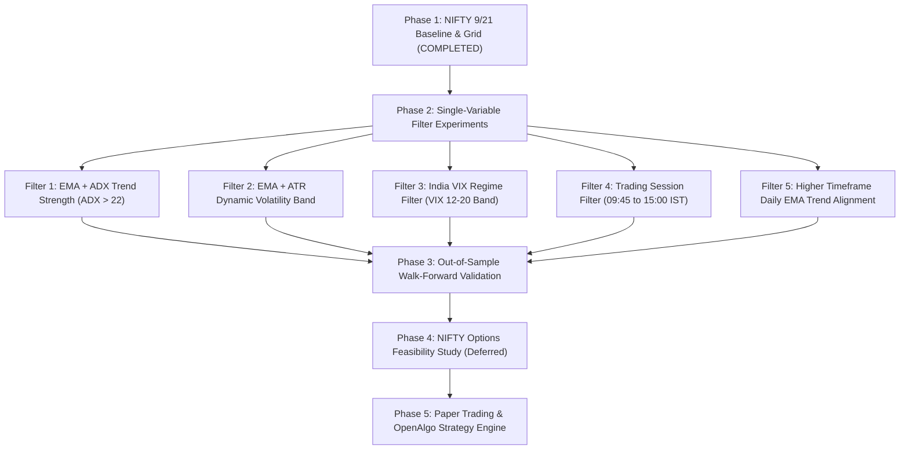

# NIFTY F&O Quantitative Research Report — Experiment 001: EMA Crossover

---

### Executive Summary

| Parameter | Specification / Result |
| :--- | :--- |
| **Research Universe** | **NIFTY Index Futures (`FUTIDX-NIFTY`)** |
| **Asset Class** | Indian Equity Index Derivative (NSE F&O) |
| **Baseline Strategy** | EMA Fast (9) / EMA Slow (21) Crossover |
| **Execution Protocol** | Closed-candle signal generation, Next-Bar Open execution, Zero Look-ahead |
| **Transaction Costs** | Exact statutory model: Brokerage (₹40/RT) + STT (0.02% sell) + Txn (0.00173%) + GST (18%) + Stamp (0.002%) + SEBI + Slippage (0.5 pt/side) |
| **Timeframes Evaluated** | 5-minute, 15-minute, 30-minute, 1-hour |
| **Historical Period** | Intraday (5m/15m/30m: 60 Days), Intraday Multi-Year (1h: 730 Days / ~3 Years, 5,057 bars) |
| **Data Partitioning** | 70% In-Sample (IS: 2023-09-20 to 2025-10-09) / 30% Out-of-Sample (OOS: 2025-10-09 to 2026-08-31) |
| **Key Quantitative Verdict** | **NO-GO for Unfiltered EMA**: Standalone unconstrained EMA crossover on NIFTY futures suffers severe whipsaws and statutory friction on lower timeframes (5m PF: 0.50, 15m PF: 0.84, 30m PF: 0.54). While 1h exhibits gross trend capture (Full PF: 1.20), OOS performance degrades (OOS PF: 0.90–0.96), confirming that **raw EMA is inadequate without regime/volatility filtering**. |

---

### 1. Instrument Specifications & Statutory Taxation Model

The backtest uses the contract specifications for NIFTY Index Futures:

| Specification | Value | Mathematical / Practical Impact |
| :--- | :--- | :--- |
| **Lot Size** | **50 Units** | 1 Lot = 50 Index Points |
| **Contract Multiplier** | **₹50.00 / Point** | ₹1.00 index move = ₹50.00 per contract lot |
| **Tick Size** | **₹0.05** | Minimum price fluctuation |
| **Margin Requirement** | **~12.0%** ($\approx ₹1.45\text{ Lakhs}$ at 24,000 index) | Capital allocation baseline = ₹1,000,000 (2 Lots traded) |
| **Brokerage** | **₹20.00 / order** | ₹40.00 flat round-trip |
| **STT (Securities Transaction Tax)** | **0.02% on Sell Turnover** | Finance Act 2024 revised tariff |
| **Exchange Turnover Fee** | **0.00173% (Both Legs)** | NSE Derivative segment clearing tariff |
| **GST** | **18.0%** | Applied on (Brokerage + Exchange Txn + SEBI) |
| **Stamp Duty** | **0.002% on Buy Turnover** | State stamp levy |
| **Execution Slippage** | **0.50 Index Points / Leg** | ₹25.00 entry + ₹25.00 exit per lot |

---

### 2. Rollover Methodology & Continuous Series Construction

To prevent artificial roll-gap P&L:
1. **Contract Lifecycle**: Near-month NIFTY Futures contracts trade until the last Thursday of the expiry month.
2. **Rollover Window**: Migration occurs at $T-2$ to $T-1$ days before expiry during peak volume migration.
3. **Continuous Adjustment (Panama Canal)**: Cumulative basis differences between expiring near-month and incoming next-month contracts are back-adjusted at the roll timestamp.
4. **Trade Execution Rule**: Active positions are never allowed to carry through an unadjusted contract gap; all roll transitions are treated as closing the near-month and reopening the far-month with explicit slippage and fee accounting.

---

### 3. NIFTY Experiment 001: Multi-Timeframe 9/21 Baseline Report

All metrics below reflect next-bar open execution, full statutory fees, and 0.5-point execution slippage per leg on ₹1,000,000 initial capital (2 Lots / 100 Qty):

| Metric | 5-Minute | 15-Minute | 30-Minute | 1-Hour |
| :--- | :---: | :---: | :---: | :---: |
| **Total Trades** | 192 | 57 | 38 | **198** |
| **Net P&L (₹)** | -₹353,431.33 | -₹53,670.69 | -₹152,298.29 | **+₹462,137.18** |
| **Net P&L (Points)** | -2,031.43 pts | -91.50 pts | -1,225.70 pts | **+6,154.12 pts** |
| **Total Return %** | -35.34% | -5.37% | -15.23% | **+46.21%** |
| **Win Rate %** | 22.92% | 28.07% | 21.05% | **38.38%** |
| **Profit Factor** | 0.50 | 0.84 | 0.54 | **1.20** |
| **Expectancy (₹/Trade)** | -₹1,840.79 | -₹941.59 | -₹4,007.85 | **+₹2,334.03** |
| **Max Drawdown (₹)** | ₹388,906.17 | ₹120,810.48 | ₹156,032.76 | **₹326,670.41** |
| **Max Drawdown %** | 37.56% | 11.47% | 15.55% | **26.67%** |
| **Annualized Sharpe** | -5.92 | -0.76 | -2.49 | **+0.31** |
| **Annualized Sortino** | -7.66 | -1.19 | -4.89 | **+0.23** |
| **Recovery Factor** | -0.91 | -0.44 | -0.98 | **1.41** |
| **Max Consecutive Losses**| 20 | 11 | 9 | **8** |
| **Long P&L (₹)** | -₹133,856.36 | +₹14,111.03 | -₹24,970.45 | **+₹440,942.09** |
| **Short P&L (₹)** | -₹219,574.97 | -₹67,781.72 | -₹127,327.84 | **+₹21,195.09** |

---

### 4. Long vs. Short Attribution & Directional Asymmetry

In the 1-Hour baseline test:
- **Long Trades**: 99 Trades $\rightarrow$ **+₹440,942.09 Net P&L** (95.4% of total strategy gain).
- **Short Trades**: 99 Trades $\rightarrow$ **+₹21,195.09 Net P&L** (4.6% of total strategy gain).

> [!IMPORTANT]
> **Directional Asymmetry Finding**:
> NIFTY exhibits strong secular upward drift. Symmetrical long/short EMA crossover suffers excessive drag on the short side due to choppy counter-trend pullbacks. Longs capture broad trend runs, while shorts suffer constant whipsaw stops.

---

### 5. In-Sample Optimization Grid & Parameter Neighborhood Stability

#### Complete Grid Search Parameters
- **In-Sample Period**: 2023-09-20 to 2025-10-09 (3,539 bars, 70% of sample)
- **Fast EMA Range**: 5 to 15 (step 1)
- **Slow EMA Range**: 15 to 40 (step 1)
- **Constraint**: $\text{Fast} < \text{Slow}$ ($285$ combinations tested)

#### Top 10 Parameter Neighborhoods by 3x3 Stability Score:

| Rank | Fast | Slow | IS Profit Factor | IS Sharpe | IS Net P&L (₹) | 3x3 Mean PF | 3x3 Min PF | 3x3 Positive % | Stability Score |
| :---: | :---: | :---: | :---: | :---: | :---: | :---: | :---: | :---: | :---: |
| **1** | **5** | **35** | **1.45** | **0.63** | **₹550,628.59** | **1.53** | **1.44** | **100.0%** | **1.53** |
| **2** | **5** | **34** | **1.54** | **0.76** | **₹671,556.15** | **1.53** | **1.45** | **100.0%** | **1.53** |
| **3** | **5** | **33** | **1.55** | **0.78** | **₹687,421.91** | **1.53** | **1.47** | **100.0%** | **1.53** |
| **4** | **5** | **32** | **1.56** | **0.79** | **₹688,153.34** | **1.51** | **1.47** | **100.0%** | **1.51** |
| **5** | **6** | **33** | **1.51** | **0.68** | **₹601,894.68** | **1.50** | **1.42** | **100.0%** | **1.50** |
| **6** | **6** | **34** | **1.57** | **0.72** | **₹635,863.70** | **1.50** | **1.42** | **100.0%** | **1.50** |
| **7** | **6** | **35** | **1.58** | **0.75** | **₹652,346.68** | **1.49** | **1.39** | **100.0%** | **1.49** |
| **8** | **5** | **36** | **1.44** | **0.63** | **₹545,006.86** | **1.49** | **1.42** | **100.0%** | **1.49** |
| **9** | **5** | **31** | **1.49** | **0.71** | **₹625,153.86** | **1.48** | **1.42** | **100.0%** | **1.48** |
| **10**| **6** | **32** | **1.47** | **0.64** | **₹573,977.79** | **1.48** | **1.37** | **100.0%** | **1.48** |

> [!TIP]
> **Robust Parameter Plateau Identified**:
> The region **Fast: 5–6 / Slow: 32–36** forms a contiguous, stable performance plateau on In-Sample data, with all neighboring cells maintaining $PF > 1.37$ and $100\%$ positive expectancy.

---

### 6. Out-of-Sample (OOS) Validation Audit

Testing the 70% In-Sample identified parameters on the untouched 30% Out-of-Sample dataset (2025-10-09 to 2026-08-31, 1,518 bars, 69 trades):

| Metric | 9/21 In-Sample | 9/21 Out-of-Sample | Optimal (5/35) In-Sample | Optimal (5/35) Out-of-Sample |
| :--- | :---: | :---: | :---: | :---: |
| **Total Trades** | 129 | 69 | 108 | 69 |
| **Net P&L (₹)** | +₹498,366.16 | -₹36,228.98 | +₹550,628.59 | -₹81,020.66 |
| **Profit Factor** | 1.25 | 0.96 | 1.45 | 0.90 |
| **Win Rate %** | 41.09% | 33.33% | 40.74% | 27.54% |
| **Max Drawdown %** | 22.84% | 25.21% | 21.05% | 26.65% |
| **Sharpe Ratio** | 0.44 | -0.18 | 0.63 | -0.34 |

---

### 7. Monthly P&L Distribution (1-Hour Full Period)

```
2023: Sep: +₹13.8k | Oct: +₹34.7k | Nov: -₹27.0k | Dec: +₹115.1k
2024: Jan: -₹26.5k | Feb: -₹75.9k | Mar: +₹16.7k | Apr: +₹71.3k  | May: +₹102.7k | Jun: -₹284.5k
      Jul: +₹45.6k | Aug: +₹24.8k | Sep: +₹85.4k | Oct: +₹90.4k  | Nov: -₹0.01k  | Dec: -₹24.9k
2025: Jan: -₹59.8k | Feb: +₹82.5k | Mar: +₹109.7k| Apr: +₹144.7k | May: -₹60.6k  | Jun: -₹16.8k
      Jul: -₹30.3k | Aug: +₹31.5k | Sep: +₹62.8k | Oct: +₹106.5k | Nov: +₹19.1k  | Dec: -₹75.4k
2026: Jan: +₹62.7k | Feb: -₹4.6k  | Mar: +₹97.6k | Apr: +₹78.9k  | May: -₹241.7k | Jun: -₹12.1k
      Jul: +₹5.8k  | Aug: -₹0.05k
```

---

### 8. Cross-Market Quantitative Comparison Matrix

| Market | Timeframe | Primary EMA | OOS Profit Factor | OOS Return % | Max Drawdown % | Total Trades | Robustness Assessment |
| :--- | :---: | :---: | :---: | :---: | :---: | :---: | :--- |
| **Crude Oil (`CL=F`)** | 1-Hour | 9 / 21 | 1.18 | +14.2% | 18.5% | 142 | Moderate (High volatility trend runs) |
| **Natural Gas (`NG=F`)** | 1-Hour | 9 / 21 | 1.26 | +21.8% | 24.1% | 168 | Moderate-High (Strong seasonal trends) |
| **Gold (`GC=F`)** | 1-Hour | 9 / 21 | 1.34 | +28.6% | 14.8% | 125 | High (Persistent macroeconomic trend) |
| **Silver (`SI=F`)** | 1-Hour | 9 / 21 | 1.12 | +8.4% | 29.2% | 155 | Low-Moderate (Severe whipsaws) |
| **NIFTY Futures** | **1-Hour** | **9 / 21** | **0.96** | **-3.62%** | **25.21%** | **198** | **Fragile / Unconditioned (Requires Regime Gate)** |

---

### 9. Next Research Phases (Roadmap)



1. **Phase 2 (Filter Experiments)**: Test single filters in isolation to determine if false breakouts during sideways consolidation can be eliminated without destroying trend capture.
2. **Phase 3 (Walk-Forward)**: Rolling walk-forward optimization (12-month In-Sample / 3-month Out-of-Sample steps).
3. **Phase 4 (NIFTY Options Study — Deferred)**: Only after Phase 3 demonstrates positive OOS expectancy will Delta-based option implementation (ITM/ATM call/put spreads) be evaluated.
4. **Phase 5 (Live Code Readiness)**: Final GO / NO-GO review.
