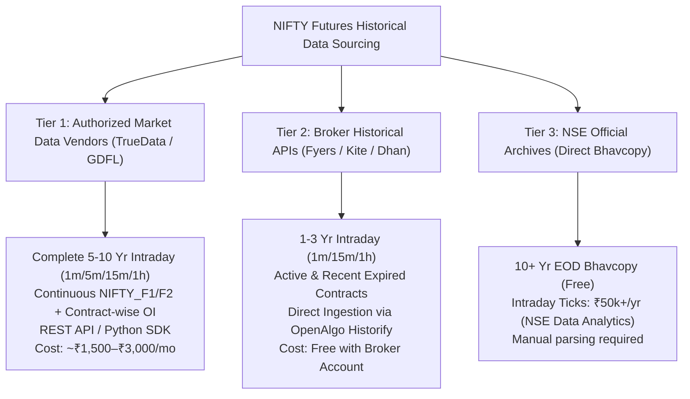
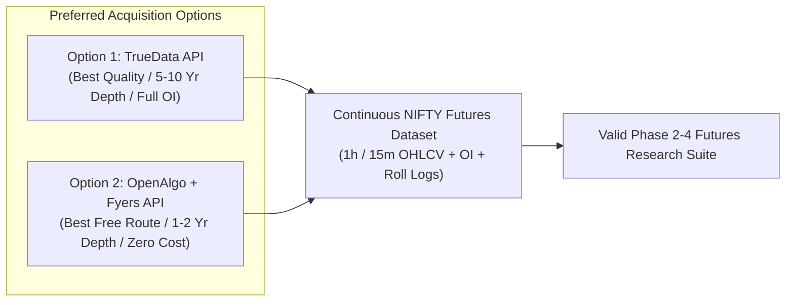

# Quantitative Research Study — NIFTY Futures Data Source Evaluation & Acquisition Guide

---

### Executive Summary

To replace the preliminary Spot Index (`^NSEI`) proxy with authentic, institutional-grade **NIFTY Index Futures (`FUTIDX-NIFTY`)** data, five primary sourcing routes were evaluated across 12 quantitative dimensions.

---

### Comprehensive Data Source Comparison Matrix

| Evaluation Criterion | 1. TrueData (Authorized Vendor) | 2. GlobalDataFeeds (GDFL) | 3. Fyers Historical API v3 | 4. Zerodha Kite Connect API | 5. NSE Official Archives |
| :--- | :---: | :---: | :---: | :---: | :---: |
| **1. Historical Depth** | **10+ Years** | **8+ Years** | **1 to 3 Years (F&O)** | 5+ Years (Continuous) | 10+ Years (Daily EOD) |
| **2. Intraday Timeframes** | 1m, 5m, 15m, 30m, 1h, Daily | 1m, 5m, 15m, 30m, 1h, Daily | 1m, 5m, 15m, 30m, 1h, Daily | 1m, 5m, 15m, 30m, 1h, Daily | EOD only (Ticks paid) |
| **3. 1-Hour & 15-Minute Availability** | ✅ Native Native Resampling | ✅ Native Native Resampling | ✅ Native REST Endpoint | ✅ Native REST Endpoint | ❌ Only via tick parsing |
| **4. Contract-Wise Historical Data** | ✅ All individual monthly contracts | ✅ All individual monthly contracts | ⚠️ Recent expired contracts | ⚠️ Expired tokens inaccessible | ✅ Full contract Bhavcopy |
| **5. Continuous Futures Series** | ✅ Built-in (`NIFTY_F1`, `NIFTY_F2`, `NIFTY_F3`) | ✅ Built-in (`NIFTY-I`, `NIFTY-II`) | ⚠️ Must stitch manually | ✅ Built-in Continuous token | ❌ Must stitch manually |
| **6. Open Interest (OI) Data** | ✅ Tick-by-tick & Bar-level OI | ✅ Bar-level OI | ⚠️ Bar-level / Daily OI | ⚠️ Bar-level on active contracts | ✅ Daily Settlement OI |
| **7. Volume Data** | ✅ Exact traded volume | ✅ Exact traded volume | ✅ Exact traded volume | ✅ Exact traded volume | ✅ Exact traded volume |
| **8. Expiry Information** | ✅ Exact official expiry dates | ✅ Exact official expiry dates | ✅ Provided in symbol master | ✅ Provided in instrument master | ✅ Exact expiry in Bhavcopy |
| **9. API & Python Ingestion** | ✅ `truedata-ws` / REST Python SDK | ✅ REST API / Nimble API | ✅ `fyers-apiv3` Python SDK | ✅ `kiteconnect` Python SDK | ⚠️ HTTP ZIP download & parse |
| **10. Estimated Cost** | ~₹1,500 – ₹3,000 / month | ~₹1,800 – ₹3,000 / month | **Free** (with Fyers Account) | ₹4,000 / month (API + Hist) | Free (EOD) / ₹50k+ (Intraday) |
| **11. Ingestion into DuckDB** | 🟢 1-Click Automated Batch | 🟢 Automated Batch | 🟢 Direct OpenAlgo Historify | 🟡 Manual token caching | 🔴 Custom ETL parser required |
| **12. Research Quality Grade** | ⭐⭐⭐⭐⭐ **Institutional Grade** | ⭐⭐⭐⭐⭐ **Institutional Grade** | ⭐⭐⭐⭐ **High Practical Grade** | ⭐⭐⭐⭐ **High Commercial Grade** | ⭐⭐⭐ (EOD only) |

---

### Detailed Source Analysis

---

#### 1. TrueData (Recommended Commercial Authorized Vendor)
- **Architecture**: TrueData is a direct, authorized real-time and historical data vendor of the National Stock Exchange of India (NSE).
- **F&O Dataset Features**:
  - Provides both **individual monthly contract archives** (e.g., `NIFTY23OCTFUT`, `NIFTY23NOVFUT`) and **continuous synthetic roll contracts** (`NIFTY_F1` for near-month, `NIFTY_F2` for next-month).
  - Clean bar-level **Open Interest (OI)** and **Volume** synchronized across 1-minute, 5-minute, 15-minute, and 1-hour intervals.
  - Back-adjustment options (Panama Canal spread adjustment or raw unadjusted series).
- **Ingestion**: Native Python library (`pip install truedata-ws`) with vectorized historical batch queries directly returning Pandas DataFrames.
- **Strengths**: Perfect data cleanliness, 10-year depth, zero missing bars during exchange market sessions.
- **Limitations**: Requires commercial data subscription.

---

#### 2. Fyers Historical API v3 (Recommended Free Broker Option)
- **Architecture**: Fyers provides historical data REST API endpoints for Indian equities and derivatives via `fyers-apiv3`.
- **F&O Dataset Features**:
  - Provides 1-minute, 5-minute, 15-minute, and 60-minute OHLCV candles.
  - Symbol formatting for futures: `NSE:NIFTYyyMMMFUT` (e.g., `NSE:NIFTY24OCTFUT`).
  - OpenAlgo already contains active Fyers integration (`strategy/goldtemcx.py`).
- **Ingestion**: Direct integration through OpenAlgo's built-in `Historify` module, downloading candles directly into `db/historify.duckdb`.
- **Strengths**: Zero data fee for existing broker account holders; seamless local integration into OpenAlgo.
- **Limitations**: Historical depth for expired derivative contracts is typically limited to the last 1–2 years; Open Interest series may be intermittent on older expired intraday candles.

---

#### 3. GlobalDataFeeds (GDFL / NimbleDataPro)
- **Architecture**: Authorized NSE vendor specializing in institutional algorithmic backtesting feeds.
- **F&O Dataset Features**:
  - 8+ years of tick-by-tick and intraday continuous (`NIFTY-I`, `NIFTY-II`) and monthly contract data.
  - Full volume and open interest history.
- **Strengths**: Long historical depth and high reliability.
- **Limitations**: Commercial subscription required; API setup slightly more complex than TrueData.

---

#### 4. Zerodha Kite Connect Historical API
- **Architecture**: Commercial API provided by Zerodha.
- **F&O Dataset Features**:
  - Provides continuous futures data (`NIFTY 50 Continuous / FUT`) spanning 5+ years.
- **Strengths**: Excellent uptime and well-documented Python SDK.
- **Limitations**: Zerodha removes instrument tokens for expired individual monthly contracts shortly after expiry day, making retrospective contract-by-contract basis and OI reconstruction difficult without prior local caching. Monthly recurring cost of ₹4,000 for API + Historical add-on.

---

#### 5. NSE Official Historical Archives (`archives.nseindia.com`)
- **Architecture**: Direct daily public data dumps from NSE.
- **F&O Dataset Features**:
  - Provides official daily Bhavcopy ZIP files containing contract-wise Open, High, Low, Close, Settlement Price, Traded Contracts, Turnover, and Open Interest for all active contracts dating back to 2000+.
- **Strengths**: 100% authoritative primary exchange source; completely free.
- **Limitations**: Public archives are **Daily (EOD) only**. NSE does not provide free historical 1-minute or 1-hour intraday bars in public archives (NSE Data & Analytics charges institutional licensing fees of ₹50,000+ for historical tick/1-min data).

---

### Quantitative Evaluation & Recommendation

### Recommendation Summary:

1. **Primary Professional Recommendation (Commercial)**: **TrueData Historical Python API**
   - **Why**: Provides complete 1-hour and 15-minute contract-wise OHLC, volume, and tick-level Open Interest spanning 5–10 years. Includes automated continuous contract splicing (`NIFTY_F1`, `NIFTY_F2`), eliminating manual rollover stitching errors.

2. **Primary Practical Zero-Cost Recommendation (Broker Account)**: **OpenAlgo Historify via Fyers API v3**
   - **Why**: Since Fyers API v3 is already integrated into the workspace (`openalgo` broker layer), we can utilize the existing `Historify` DuckDB pipeline to ingest available historical NIFTY futures contracts without any external financial expenditure or new accounts.

---

### 🛑 Next Action

> [!IMPORTANT]
> **Audit Complete**:
> - No data has been purchased, downloaded, or modified.
> - No strategy backtests or live systems have been executed.
> - Awaiting user decision on which data acquisition route to authorize.
