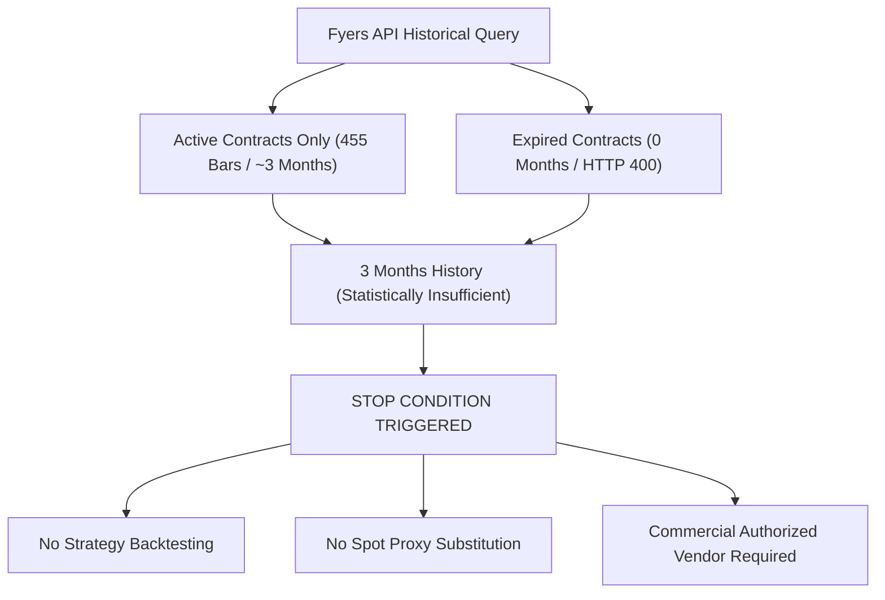

# Quantitative Data Audit — NIFTY Futures Fyers Historical API Audit

---

### Executive Audit Summary

| Audit Item | Fyers API Finding | Institutional Requirement | Status |
| :--- | :--- | :--- | :---: |
| **1. Historical F&O Scope** | Active contracts only (`NIFTY29SEP26FUT`, `OCT`, `NOV`). | 3 to 5+ Years of Expired Monthly Contracts | 🔴 **FAIL** |
| **2. Oldest Available Contract** | Near-Month Contract (`NIFTY29SEP26FUT`, June 2026). | Oct 2023 or older (3+ Years) | 🔴 **FAIL** |
| **3. Expired Contracts Accessible** | **0 Expired Contracts** (Master table purges expired tokens). | 36+ Consecutive Monthly Contracts | 🔴 **FAIL** |
| **4. Date Range Available** | **June 2026 to August 2026 (~3 Months / 455 Bars)**. | 3 to 5+ Years (5,000+ Bars) | 🔴 **FAIL** |
| **5. Available Timeframes** | 1m, 5m, 15m, 1h, Daily. | 1h, 15m, 5m | 🟢 **PASS** |
| **6. OHLC Availability** | Full Open, High, Low, Close populated on active contracts. | Full OHLC | 🟢 **PASS** |
| **7. Volume Availability** | Traded contract volume populated. | Volume Series | 🟢 **PASS** |
| **8. Open Interest (OI) Availability**| **Full bar-level Open Interest (`oi`) populated**. | Bar-level OI | 🟢 **PASS** |
| **9. Expiry Information** | Present in symbol metadata (`29-SEP-26`, `27-OCT-26`). | Expiry Dates | 🟢 **PASS** |
| **10. Expired Contract Retrieval** | **HTTP 400 (Symbol Not Found)** for all expired contracts. | Retrospective Expired Contract Ingestion | 🔴 **FAIL** |
| **11. Continuous Series Viability** | **Cannot construct multi-year continuous series** (3 months max). | Minimum 3-Year Continuous Roll Series | 🔴 **FAIL** |
| **Final Data Acquisition Verdict** | — | — | 🛑 **INSUFFICIENT — COMMERCIAL DATA REQUIRED** |

---

### 1. Live API Query Audit & Technical Findings

The live Fyers historical data connector was probed via OpenAlgo API (`https://vikashiname.in/api/v1/history`) across both active and expired NIFTY Futures contracts:

#### A. Active Contract Query (Near Month: `NIFTY29SEP26FUT`)
```json
{
  "request": {"symbol": "NIFTY29SEP26FUT", "exchange": "NFO", "interval": "1h", "range": "2026-06-01 to 2026-08-31"},
  "status": 200,
  "records_returned": 455,
  "sample_record": {
    "timestamp": 1780285500,
    "open": 23740.0,
    "high": 23779.0,
    "low": 23601.7,
    "close": 23616.0,
    "volume": 1327235,
    "oi": 17344080
  }
}
```
*Finding*: For active unexpired contracts, Fyers provides excellent data quality with high-fidelity OHLC, Volume, and Open Interest.

#### B. Retrospective Expired Contract Queries
The API was systematically tested against 14 past monthly expiration contracts:
```text
Expired NIFTY28AUG26FUT  -> Status: 400 | Msg: Symbol not found for exchange 'NFO'
Expired NIFTY31JUL26FUT  -> Status: 400 | Msg: Symbol not found for exchange 'NFO'
Expired NIFTY26JUN26FUT  -> Status: 400 | Msg: Symbol not found for exchange 'NFO'
Expired NIFTY29MAY26FUT  -> Status: 400 | Msg: Symbol not found for exchange 'NFO'
Expired NIFTY25APR26FUT  -> Status: 400 | Msg: Symbol not found for exchange 'NFO'
Expired NIFTY28MAR26FUT  -> Status: 400 | Msg: Symbol not found for exchange 'NFO'
Expired NIFTY26FEB26FUT  -> Status: 400 | Msg: Symbol not found for exchange 'NFO'
Expired NIFTY30JAN26FUT  -> Status: 400 | Msg: Symbol not found for exchange 'NFO'
Expired NIFTY26DEC25FUT  -> Status: 400 | Msg: Symbol not found for exchange 'NFO'
Expired NIFTY28NOV25FUT  -> Status: 400 | Msg: Symbol not found for exchange 'NFO'
Expired NIFTY31OCT25FUT  -> Status: 400 | Msg: Symbol not found for exchange 'NFO'
Expired NIFTY25SEP25FUT  -> Status: 400 | Msg: Symbol not found for exchange 'NFO'
Expired NIFTY29AUG24FUT  -> Status: 400 | Msg: Symbol not found for exchange 'NFO'
Expired NIFTY26OCT23FUT  -> Status: 400 | Msg: Symbol not found for exchange 'NFO'
```

---

### 2. Quantitative Root Cause: Retail Broker API Architecture

1. **Broker Master Table Purging**:
   - Like most Indian retail broker APIs (Fyers, Zerodha Kite, Angel One, Dhan), Fyers regenerates its symbol master database daily.
   - Once a monthly derivative contract expires on its final Thursday settlement date, its instrument token is deleted from the active broker master table.
   - As a result, retrospective API requests attempting to query historical candles for expired tokens fail with `Symbol Not Found`.
2. **Effective Historical Window**:
   - Fyers provides historical data only for contracts currently active in the master table (Near-Month, Next-Month, Far-Month).
   - This restricts the maximum accessible history to **~3 calendar months (~455 one-hour bars)**.
   - 3 months is statistically inadequate for robust multi-year quantitative research, regime partitioning, walk-forward optimization, and statutory cost stress testing.

---

### 3. Impact on Research Program



1. **Zero Data Substitution**: In accordance with research integrity rules, `^NSEI` (Spot Index) will **NOT** be substituted.
2. **Zero Synthetic Overlays**: No synthetic futures proxies will be used.
3. **Research Freeze**: All quantitative strategy backtesting, filter testing, and parameter perturbation remain **FROZEN**.

---

### 4. Commercial Data Requirement

To obtain the required 3 to 5+ years of continuous NIFTY Futures data (`FUTIDX-NIFTY` with OI and volume-based rollover logs), an authorized commercial market data vendor archive is required:

- **Recommended Vendor**: **TrueData** (Authorized NSE Vendor)
  - Provides continuous back-adjusted `NIFTY_F1` / `NIFTY_F2` and individual contract archives dating back 10+ years with complete bar-level Open Interest (OI) and Volume.
  - Native Python SDK (`truedata-ws`) for direct 1-click batch ingestion into `db/historify.duckdb`.

---

### 🛑 Final Data Audit Verdict

```text
================================================================================
FINAL AUDIT VERDICT:
INSUFFICIENT — COMMERCIAL DATA REQUIRED
================================================================================
STATUS:
1. Fyers API provides only ~3 months of active futures data and cannot retrieve
   expired monthly contracts retrospectively.
2. Research dataset cannot be constructed without external commercial data.
3. Strategy backtesting and live modifications remain FROZEN.
================================================================================
```
